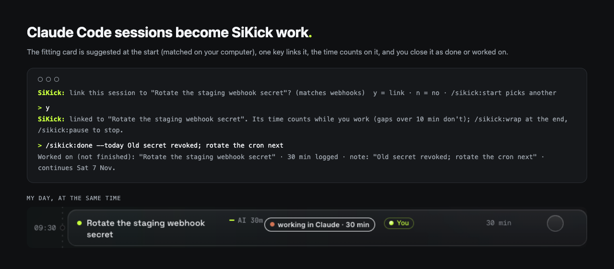

# SiKick for Claude Code

Turn your Claude Code sessions into SiKick work. At the start of a session the plugin suggests the card on your SiKick
day (My day) that fits the folder and git branch you are in; one key links it. While you work, the time counts on that
card (idle gaps do not, a paused session does not). At the end you mark the card done, or log it as worked on with a
note (it then continues on your next working day, the same as ↻ on My day), and turn follow-ups from the session into
cards you pick. Nothing is ever filed without your yes.

*The plugin's real messages and the My day row they produced, from the end-to-end test against a local SiKick.*

You need a SiKick account (<https://www.sikick.si>).

## Set up

1. Install: `/plugin marketplace add sikick-app/sikick` then `/plugin install sikick@sikick` (or, once it is listed, find
   **SiKick** in the plugin directory). Restart Claude Code or run `/reload-plugins`.
2. Connect: open <https://www.sikick.si/app/claude> signed in, press **Make a token**, and run the line it shows in your
   terminal. It writes `~/.sikick/token` (mode 600). Without a token the plugin does nothing at all.
3. Check: `/sikick:status`.

## How a session goes

- **Start.** `SiKick: link this session to "Fix login redirect" [acme]? (matches branch fix/login-redirect)  y = link · n = no`.
  Type `y` (or `n`). The answer is handled by the plugin and never reaches Claude. The match is computed on your
  computer from the folder name, the branch, the cards you linked here before and, if your first message is a task,
  its words. If your first message is a task, Claude adds the suggestion as one line at the end of its reply; answer
  `sk y` then. On a resumed session a bare `y` is never taken (it might answer Claude); use `sk y`.
- **While you work.** My day shows `● working in Claude · 42 min` on the card. Minutes come from the session's own
  events; a gap over 10 minutes is not counted. If you linked after working a while, the session's time so far today
  counts on the card too.
- **End.** `/sikick:wrap`: Claude writes a one-line note and asks *done · worked on · leave it*, then lists follow-ups
  (TODO / FIXME lines this session added, open ends from the conversation) and asks which to add as cards. If you just
  quit, the next session in the same folder offers it: `d` done · `w <note>` worked on · `n` leave it.

## Commands

| Command | What it does |
|---|---|
| `/sikick:start [card]` | link this session to a card (no argument: pick from My day) |
| `/sikick:wrap [note]` | end of session: done / worked on with a note, follow-ups into cards you pick |
| `/sikick:done [--today] [note]` | finish the linked card; `--today` = worked on, not finished (continues next working day) |
| `/sikick:today` · `/sikick:next` | your day; the next card |
| `/sikick:bug "…"` | file a bug into the linked card's project (New from chat), else your day |
| `/sikick:pause` | pause / resume: nothing is sent, the time stops |
| `/sikick:status` | connection (live / local / custom address), linked card, minutes, waiting events |
| `/sikick:persona [show \| delete]` | build your work persona from your local history; you approve it before upload |

Two MCP servers come with it: `flow` (local, `mcp/server.mjs`: `today`, `next_card`, `card_context`, `mark_done`,
`new_card`, `progress`) and `sikick`, SiKick's account MCP (`my_day`, `my_cards`, `search`, …) at the `mcp_url` option.

## What is sent, and where

Everything goes only to **your SiKick address** (`https://www.sikick.si` unless you set another), over https (plain
http only to a test server on your own computer), with your token. Full list: [PRIVACY.md](PRIVACY.md).

- **Session events** (one small JSON per hook): session id, event type, time, the folder (your home folder shown as `~`)
  and its name, tool names, changed file paths relative to the project, the **length** of each prompt. Prompt **text**
  only if you turn on `send_prompts`.
- **Card actions**, only when you ask: read My day, link a card, done / worked on with your note, new card or bug, a
  progress line, your approved persona.
- **Never sent:** Bash commands, tool output, file contents, diffs, transcripts, your branch name, the TODO scan, the
  words used for matching.

When SiKick can't be reached, events wait in `~/.sikick/queue.jsonl` (at most 2000, 7 days) and go with the next one.
`/sikick:pause` stops everything for a session, locally, even offline.

## Options

`/plugin` → sikick → Configure: `sikick_url` (your SiKick address), `mcp_url` (its account MCP), `suggest_cards`
(the start-of-session suggestion, on), `send_prompts` (off). The `SIKICK_URL` environment variable wins over
`sikick_url`, which is how you point it at a staging or local SiKick.

## Requirements and license

Claude Code with plugin support and Node.js 18 or newer (no packages are installed). MIT license.
